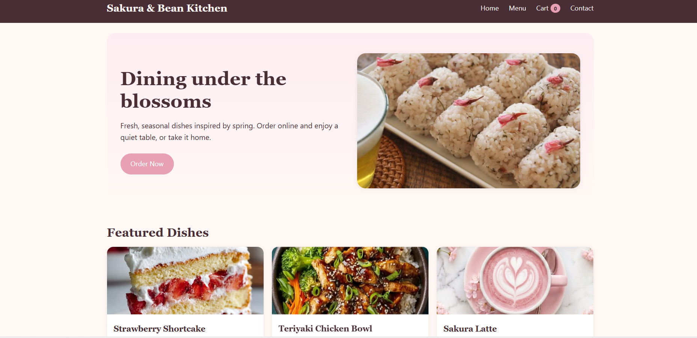
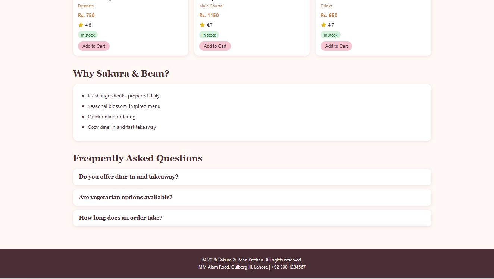
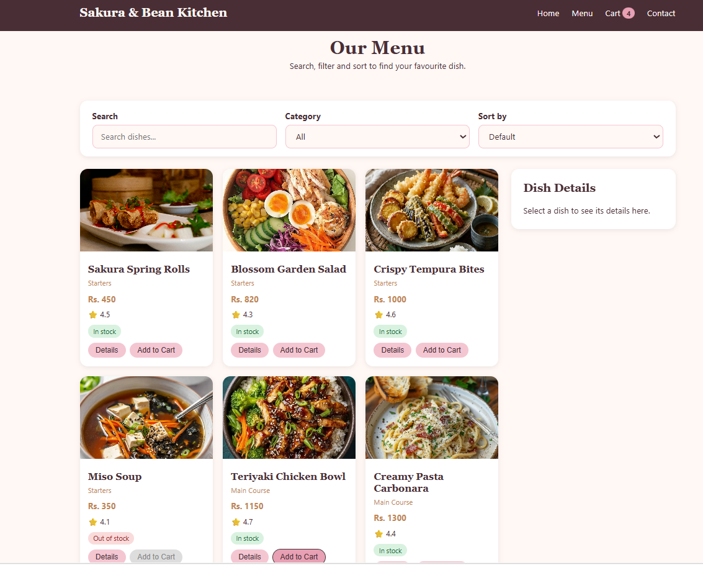
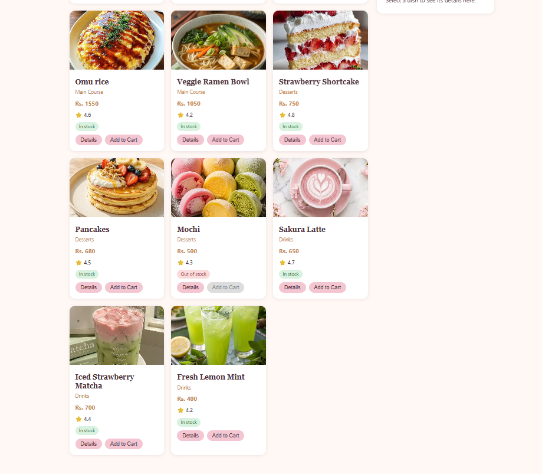
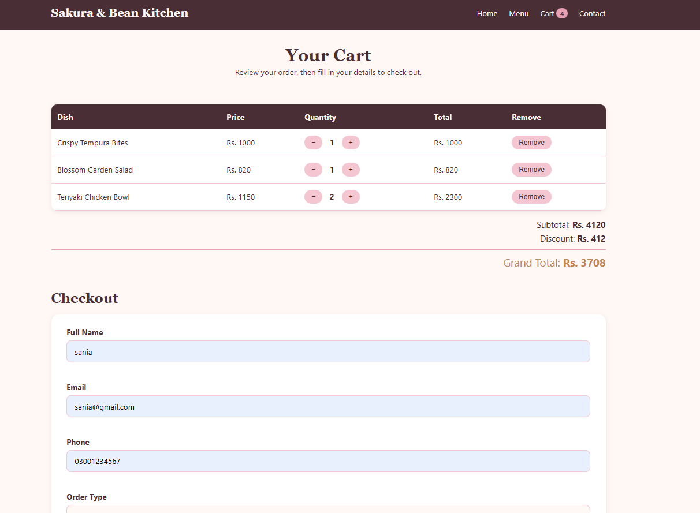
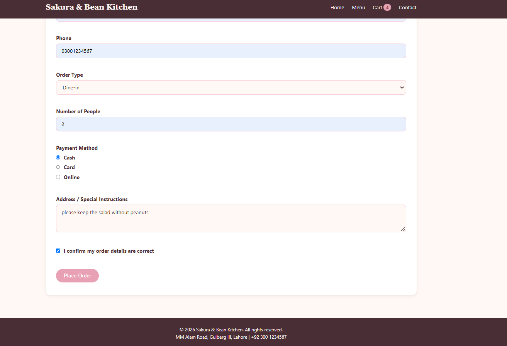
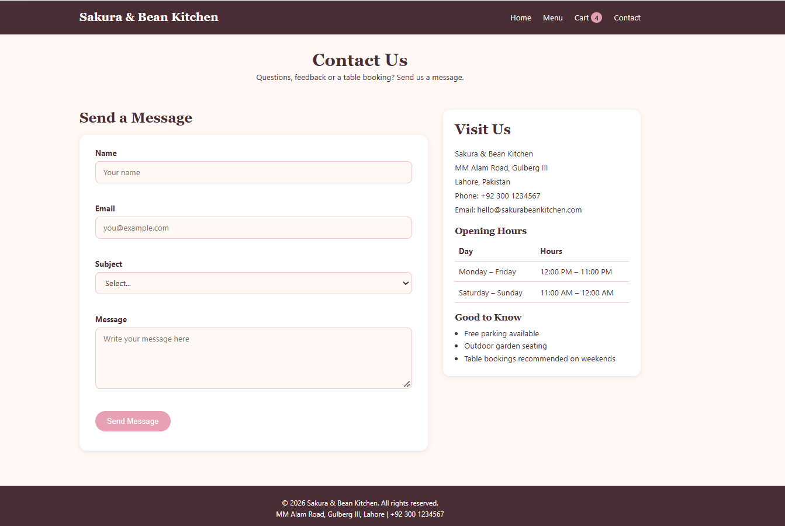

# Sakura & Bean Kitchen

A front-end restaurant menu and ordering website built with HTML5, CSS3, JavaScript (ES6) and jQuery. Customers can browse the menu, search, filter and sort dishes, add items to a cart, see the bill update instantly, and fill in a checkout form. No back end is used.

**Course:** Web Engineering, Assignment No. 2
**University:** The University of Lahore, BSCS
**Theme:** Restaurant menu and ordering

## Live Demo and Repository
- **Live site:** https://saniasultan666.github.io/sakura-bean-kitchen/
- **Repository:** https://github.com/Saniasultan666/sakura-bean-kitchen

## Team Members and Roles
Name: Sania Sultan 
Sap ID: 70176777
Individual project: HTML, CSS, JavaScript, jQuery, documentation 

## Pages
| Page | Description |
|---|---|
| `index.html` | Home: hero banner, featured dishes, "Why Sakura & Bean" list, FAQ accordion |
| `products.html` | Menu: search, category filter, sorting, dish grid, details panel |
| `cart.html` | Cart table, quantity buttons, totals, checkout form |
| `contact.html` | Contact form, restaurant address, opening hours table |

## Features Implemented

### HTML
- Four pages linked by a common navigation bar
- Semantic structure (`header`, `nav`, `main`, `section`, `article`, `aside`, `footer`)
- Images with alt text, lists, and tables (cart and opening hours)
- Checkout form with 8 fields of different types (text, email, tel, select, number, radio, textarea, checkbox) and HTML5 validation attributes (`required`, `pattern`, `minlength`, `min`)

### CSS
- One external stylesheet (`css/style.css`) with CSS variables for the colour palette
- Flexbox for the navigation bar, hero, controls and layouts; CSS Grid for the product listing
- Responsive design with breakpoints at 768px and 480px (the product grid changes from 3 to 2 to 1 columns)
- Hover and focus states on buttons, links, inputs and cards

### JavaScript (`js/store.js`)
- 14 dishes stored as an array of objects (loaded from `products.json`)
- Dishes built dynamically from the array, not typed in HTML
- Search by name and category filter using `filter()`
- Sorting by price (low to high, high to low), name and rating using `sort()` on a copy made with the spread operator
- Details panel using `find()`
- Cart: add, remove, change quantity; subtotal, discount and grand total with `reduce()`
- Rest parameter function (`applyDeductions`)
- Event delegation for product and cart buttons
- Form validation with error messages beside each field, and `preventDefault()` to stop invalid submissions

### jQuery (`js/ui.js`)
- Loaded from a CDN, with all code inside `$(document).ready()`
- Products loaded from `products.json` with `$.getJSON()`, with a loading message and an error message (with a retry button)
- Effects: `.fadeIn()`, `.fadeOut()`, `.slideToggle()`, `.slideUp()`, `.animate()`
- FAQ accordion, back-to-top button, fading notification pop-up, shaking invalid form fields
- DOM methods: `.text()`, `.html()`, `.append()`, `.prop()`, `.toggleClass()`, `.removeClass()`
- Method chaining, for example on the notification pop-up

### Bonus
- Cart saved with `localStorage`, so it survives page changes and refreshes

## How the Code Is Organised
- `store.js` contains the plain JavaScript logic.
- `ui.js` contains the jQuery code (AJAX and effects).
- The two files communicate through custom events (`productsRendered`, `cartUpdated`, `detailsShown`, `formInvalid`).

## Folder Structure
```
sakura-bean-kitchen/
├── index.html
├── products.html
├── cart.html
├── contact.html
├── products.json
├── README.md
├── css/
│   └── style.css
├── js/
│   ├── store.js
│   └── ui.js
└── images/
```

## How to Run
The menu data is loaded with AJAX, so the site must be served by a local server. Opening the HTML files by double-click will not load the dishes.

1. Open the project folder in VS Code.
2. Install the **Live Server** extension (by Ritwick Dey).
3. Right-click `index.html` and choose **Open with Live Server**.

## Discount Rule
Orders with a subtotal of Rs. 3000 or more receive a 10% discount.

## Screenshots
 Home   
 Home  
 Menu  
 Menu    
 Cart and checkout  
 Cart and checkout    
 Contact |  |
 Mobile view |  |
## Credits
Food photographs were sourced from [Unsplash / Pexels / Pinterest] and are used for educational purposes only.